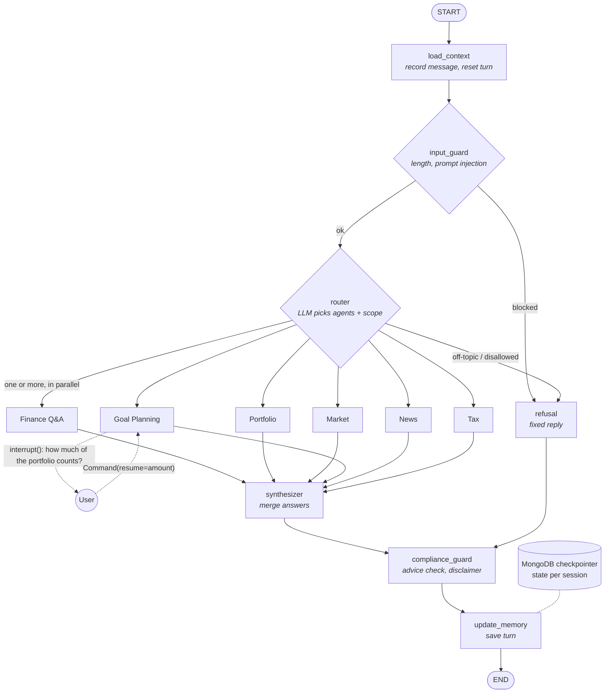

# Finnie — AI Finance Assistant

A multi-agent assistant that teaches personal finance and investing basics. Design: [docs/DESIGN.md](docs/DESIGN.md) · Specification: [SPEC.md](SPEC.md).

**Six AI specialists, one conversation.** Ask anything about money, from "What's an ETF?" to "Am I on track for my house?", and Finnie routes the question to the right experts, grounds the answer in trusted sources and explains it at the user's level.

| | What's inside |
|---|---|
| 🤖 **Multi-agent team** | Six agents: Finance Q&A, Portfolio Analysis, Market Analysis, Goal Planning, News Synthesizer and Tax Education. Each has its own prompt, data and tools, all built on one shared `BaseAgent`. When a question spans several areas, the agents **work in parallel** and their answers are merged into one reply. For example, *"Why did Tesla's stock drop this week?"* runs the **Market Analysis** agent (price moves and volatility) and the **News Synthesizer** (the headlines behind them) at the same time. |
| 🔀 **LangGraph orchestration** | An LLM router picks one or several agents, which run **in parallel**. A synthesizer merges their answers, and a compliance guard checks every reply. Every turn is checkpointed in MongoDB, so conversations survive restarts. |
| 🙋 **Human in the loop** | Before projecting a goal, the Goal Planning agent **pauses the workflow mid-turn** (LangGraph `interrupt()`) and asks how much of the user's portfolio should count toward it, showing the portfolio's current value. The user enters an amount (capped at the portfolio value), or skips, and the turn **resumes from its checkpoint** with that number. The answer can be saved to the goal so Finnie doesn't ask again, and a paused question survives a page refresh. |
| 📚 **RAG on trusted sources** | 80 articles from the SEC, FINRA, IRS, Federal Reserve, CFPB, FDIC and more, split into 475 chunks and searched with FAISS and Gemini embeddings. Retrieval is category-filtered, a relevance cut-off drops weak matches, and every answer cites its sources. **Measured** on a 78-question golden set: hit@1 97.4%, hit@3 100%, MRR 0.987, all off-topic questions rejected. |
| 📈 **Live market data** | **Alpha Vantage** quotes and price history, Google News headlines via **SerpAPI**. A **disk cache** keeps Finnie within the free tiers (about 25 Alpha Vantage requests a day, 250 SerpAPI searches a month): quotes are reused for 30 minutes, price history for 12 hours and news for 60 minutes. If an API fails or hits its limit, the last good copy is served and labelled as cached. Every figure shows its source and when it was retrieved, and missing data is flagged rather than invented. |
| 💼 **Portfolio and goals** | Holdings valued at live prices, with allocation, gain/loss, diversification score, risk level and weighted fees. Goal projections are calculated in code (expected value, low/high range, monthly amount needed, time to target), never by the LLM. |
| 💬 **Conversational and personal** | Streaming answers, follow-ups that remember context ("what about its volatility?"), and explanations matched to beginner, intermediate or advanced users and their risk tolerance. |
| 📊 **Visualizations** | Interactive Plotly charts: allocation by holding and by asset type, price trends with 50- and 200-day moving averages, and an index snapshot. The palette is checked for colorblind safety. |
| 🛡️ **Guardrails on both sides** | **Input:** card, Social Security and account numbers are removed before Gemini or the database ever sees them, messages are capped at 2,000 characters, and prompt-injection attempts, off-topic requests and requests to break the law (e.g. *"How can I launder money without the bank noticing?"*) are politely refused without running any agent. **Output:** agents never recommend trades or predict prices, the compliance guard flags advice-like phrasing, and every reply carries a disclaimer. |
| 🔐 **Accounts** | Sign-up and log-in with bcrypt-hashed passwords. Profiles, goals and portfolios are saved in MongoDB, and an HttpOnly session cookie keeps the user signed in across page refreshes. |
| ☁️ **Cloud-ready** | Non-root Docker image with a health check, deployed by AWS CDK to EC2 with ECR, Secrets Manager, CloudWatch, an Elastic IP and an IP allow-list. Production data lives in MongoDB Atlas. |
| ✅ **Tested** | 123 unit tests (agents, guardrails, workflow pause and resume, projections, stores, UI with Streamlit AppTest) plus a retrieval evaluation suite run against the real index (`pytest -m eval`). |

## LangGraph workflow



- **Before the graph:** card, Social Security and account numbers are removed from the message, so they're never stored.
- **Parallel agents:** the router can pick several agents, which run at the same time. The synthesizer merges their answers, and passes a single agent's answer through unchanged. For example, *"Why did Tesla's stock drop this week?"* runs Market and News together.
- **Human in the loop:** Goal Planning can pause the turn with `interrupt()` to ask the user a question. The turn waits in the checkpointer and resumes with the answer.
- **Every reply** passes through `compliance_guard`, refusals included, and each turn is checkpointed in MongoDB, so conversations survive restarts.

## Setup

**Requirements:** Python 3.11 or newer, and a Google AI Studio API key ([get one](https://aistudio.google.com/apikey)).

**macOS / Linux**

```bash
./scripts/setup.sh           # creates .venv, installs dependencies, creates .env
source .venv/bin/activate
```

**Windows (PowerShell) or manual setup**

```bash
python -m venv .venv
.venv\Scripts\activate       # macOS/Linux: source .venv/bin/activate
pip install -r requirements.txt
copy .env.example .env       # macOS/Linux: cp .env.example .env
```

Then open `.env` and set `GOOGLE_API_KEY`. `ALPHA_VANTAGE_API_KEY` is optional; without it there are no live prices: the Portfolio tab values holdings at the price paid, and the Market tab and Market agent say the data is unavailable. `SERP_API_KEY` is optional too; without it the News agent says news is unavailable.

**Lighter install:** `pip install -e .` installs only the runtime dependencies. Add `[dev]` for tests and linting, or `[local-embeddings]` for offline embeddings (`EMBEDDING_PROVIDER=local`, downloads PyTorch).

## Run

```bash
finnie-index --rebuild   # build the knowledge base index (or: python -m src.rag.index --rebuild)
finnie        # launches the Streamlit app
pytest        # runs the tests with coverage
pytest -m eval           # retrieval evaluation against the real index (embedding API calls)
finnie-eval-retrieval    # the same evaluation as a report: hit@k, MRR, off-topic rejection
```

When an article is added, a question for it is also added to `src/data/eval/retrieval_golden.yaml`; a test fails until every article has one.

## User accounts (MongoDB)

Sign-up and log-in store accounts in MongoDB: the login details, the profile (knowledge level, risk tolerance, interests, goals) and the portfolio. Finnie itself is for signed-in users only: the home, sign-up and log-in pages are public, and opening the assistant while logged out goes to the log-in page.

`MONGODB_URI` in `.env` points at any MongoDB (default `mongodb://localhost:27017`, database `finnie`):

- **Already installed locally** (for example with Homebrew): nothing else to do.
- **Not installed:** `docker compose up -d mongo` starts one in Docker (`MONGO_PORT=27018` if 27017 is taken).
- **Production (AWS):** a free MongoDB Atlas M0 cluster, hosted on AWS in us-east-1 and created once outside CDK, so deploys never replace it. Its connection string is stored in Secrets Manager (`finnie/mongodb-uri`), and Atlas only accepts connections from the EC2 instance's Elastic IP. Setup steps are in [infra/README.md](infra/README.md).

If MongoDB can't be reached, the sign-up and log-in pages say so and the rest of the app keeps working.

Conversations are stored in the same database (`conversation_checkpoints` and `conversation_writes`), so a restart doesn't lose them, and they're deleted 30 days after they were written (`CONVERSATION_TTL_DAYS`). They include what users tell Finnie about their goals and portfolio. If MongoDB is down when Finnie starts, conversations are kept in memory instead until the next restart; `CONVERSATION_STORE=memory` does that on purpose. Refreshing the page keeps the user signed in and shows the conversation again: a session cookie points to the saved session in MongoDB for up to 7 days (`SESSION_TTL_DAYS`), and logging out ends it.

## Run with Docker

The same image is used locally and for deployment. Build the knowledge base index first (it is copied into the image), then:

```bash
docker compose up --build        # open http://localhost:8501
FINNIE_PORT=8502 docker compose up --build   # if 8501 is already in use
docker compose down              # stop and remove the container
```

Settings and secrets are read from `.env` at run time; `.env` is never copied into the image. After adding or editing knowledge base articles, run `finnie-index --rebuild` and rebuild the image.

## Deploy to AWS

See [infra/README.md](infra/README.md) for deploying the Docker image to AWS (EC2) with CDK.

In production, accounts, sessions and conversations are stored in a MongoDB Atlas M0 cluster, whose connection string is read from Secrets Manager.
